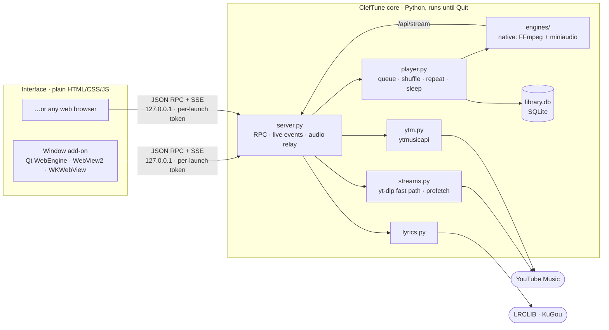

<div align="center">


# ClefTune

### Enjoy your Open-source Premiumness!

**An unofficial YouTube Music client for Windows, macOS and Linux:** ad-free, gapless and synced to your lyrics. It keeps playing when you close the window.

<p>
  
  
  
  <br>
  
  
  
</p>

[**Install**](#-install) · [**Features**](#-features) · [**Sign in**](#-signing-in-optional) · [**How it works**](#-how-it-works) · [**Build**](#-building-the-installers) · [**Develop**](#-run-from-source)

</div>

---

> [!NOTE]
> ClefTune is a fan project inspired by [Metrolist](https://github.com/MetrolistGroup/Metrolist) for Android. It is **not affiliated with YouTube, Google or Metrolist**. It talks to YouTube's internal APIs the same way Metrolist and yt-dlp do, which YouTube's Terms of Service don't allow, so use it for personal listening at your own risk.

## ✨ Highlights

<table>
<tr>
<td width="50%" valign="top">

**🎧 Music that doesn't stop**<br>
Audio plays inside the app itself, not in a browser tab, so closing the window keeps the music going. Bring it back from the app menu, tray or Dock.

**⚡ Fast starts**<br>
A new song is resolved in about half a second. The next songs in the queue, and the one under your pointer, are prepared ahead of time, so they start almost instantly.

**🎤 Lyrics, properly**<br>
Time-synced lyrics from LRCLIB, YouTube Music and KuGou. Each word lights up as it's sung, with click-to-seek and per-song timing nudges.

</td>
<td width="50%" valign="top">

**🔥 Popular first**<br>
Search puts the songs people actually play on top (ranked by play count), while keeping results that match what you typed ahead of unrelated hits.

**🔐 Safe sign-in**<br>
You sign in to Google in your own browser, never in an embedded window, so Google trusts it. ClefTune then picks up the login automatically.

**📦 Zero setup**<br>
Each installer brings its own Python, FFmpeg and JavaScript runtime. No admin rights, and nothing to install first.

</td>
</tr>
</table>

## 📥 Install

Download the installer for your system from the [Releases](https://github.com/ettisafxrup/ClefTune/releases) page.

| System                         | File                                                                           | How                                                                                     |
| ------------------------------ | ------------------------------------------------------------------------------ | --------------------------------------------------------------------------------------- |
| **Windows 10/11**              | `ClefTune-<ver>-windows-x64-setup.exe`                                         | Double-click. No admin rights needed.                                                   |
| **macOS 11+**                  | `ClefTune-<ver>-macos-arm64.pkg` (Apple Silicon) · `-macos-x86_64.pkg` (Intel) | Double-click. If macOS blocks it: _System Settings → Privacy & Security → Open Anyway_. |
| **Linux** (x86-64, any distro) | `ClefTune-<ver>-linux-x86_64.run`                                              | `chmod +x ClefTune-*.run && ./ClefTune-*.run`. No root needed.                          |

**Window or browser?** The installer asks how ClefTune should open:

- **In its own window** (recommended). Installs the small window add-on.
- **In my web browser.** A smaller install; the player opens as a browser tab.

You can switch any time in _Settings → Window_. Run the installer again to add, update or remove the window add-on, or to uninstall.

<details>
<summary><b>🗑️ Uninstalling</b></summary>

- **Windows:** _Settings → Apps → ClefTune → Uninstall_. It asks whether to also delete your library.
- **macOS:** run `/Library/Application Support/ClefTune/Uninstall ClefTune.command`.
- **Linux:** run the installer again and choose _Uninstall_, or run `~/.local/lib/cleftune/uninstall.sh` (add `--purge` to delete your library too).

Your downloaded music in `Music/ClefTune` is never deleted.

</details>

## 🤾🏻‍♂️ Features

|                          |                                                                                                                                                                                                                     |
| ------------------------ | ------------------------------------------------------------------------------------------------------------------------------------------------------------------------------------------------------------------- |
| **Browse**               | Home feed, Explore (charts, moods & genres, new releases and videos), albums, artists, playlists, radio mixes                                                                                                       |
| **Search**               | Live suggestions; filters for songs, videos, albums, artists and playlists; top result; songs ranked by popularity with duplicates removed                                                                          |
| **Now Playing**          | Full-screen player over a blurred album-art backdrop: large artwork, its own seek bar and controls, and synced lyrics alongside                                                                                     |
| **Playback**             | Shuffle, repeat / gapless repeat-one, drag-to-reorder queue, autoplay radio, sleep timer, resume where you left off                                                                                                 |
| **Lyrics**               | Synced from LRCLIB → YouTube Music → KuGou, plain text as a fallback. Karaoke-style word-by-word fill using real word timing (KuGou KRC, enhanced LRC) when available, otherwise paced by syllable (_Settings → Appearance → Word-by-word lyrics_). Click a line or word to seek, ±0.25 s timing per song. Auto-scroll pauses while you scroll yourself. Saved for offline use |
| **Cache**                | Your last 50 played songs (adjustable) stay on disk, so they play instantly and offline                                                                                                                             |
| **Library**              | Liked songs, your own playlists, saved albums/artists/playlists, listening history, 30-day stats                                                                                                                    |
| **Downloads**            | Permanent offline copies in `Music/ClefTune`, tagged with cover art when ffmpeg is available                                                                                                                        |
| **Account** _(optional)_ | Your YouTube Music likes, playlists and history; likes sync back                                                                                                                                                    |
| **Desktop**              | Media keys and the desktop media panel (Linux MPRIS), tray icon, colors from album art, dark / light / system theme                                                                                                 |

### 🤔 Where clicks take you

| In the player bar | Opens                                                                          |
| ----------------- | ------------------------------------------------------------------------------ |
| Album artwork     | **Now Playing** with lyrics (click again, or press <kbd>Esc</kbd>, to go back) |
| Song title        | The song's **album**                                                           |
| Artist name       | The **artist's** page                                                          |

### Closing vs. quitting

Closing the window (or browser tab) **keeps the music playing**. To stop completely, use **Quit** at the bottom of the sidebar or in the tray menu. You can change this in _Settings → Window_.

## 🔐 Signing in (optional)

Open _Settings → Account_ and click **Sign in with Google · via _your browser_**.

1. If you're already signed in to YouTube in your default browser, ClefTune uses that login and you're done in a second.
2. If not, Google's normal sign-in page opens **in that browser**. Sign in there as usual. ClefTune notices it within a few seconds and signs itself in; there's no window to close and nothing to copy.

Because the sign-in happens in a real, trusted browser, Google doesn't block it as an "unsafe browser", which happens with embedded sign-in windows. You can also pick any other installed browser (Firefox, Chrome, Edge, Brave, Chromium, Opera, Vivaldi, Safari), or under _Advanced_ paste request headers copied from your browser's developer tools.

> [!TIP]
> Your login is stored only on this computer (`browser_auth.json` in the library folder). To also use it for playback (age-restricted songs, Premium audio quality), turn on **Use account for playback**.

> [!IMPORTANT]
> On Windows, Chrome and Edge encrypt their cookies so other apps can't read them. If sign-in through them fails, use Firefox, or the _Advanced_ option.

## ⌨️ Keyboard shortcuts

| Key                         | Action               |     | Key                                          | Action            |
| --------------------------- | -------------------- | --- | -------------------------------------------- | ----------------- |
| <kbd>Space</kbd>            | Play / Pause         |     | <kbd>↑</kbd> <kbd>↓</kbd>                    | Volume            |
| <kbd>←</kbd> <kbd>→</kbd>   | Seek 5 s             |     | <kbd>Shift</kbd> + <kbd>←</kbd> <kbd>→</kbd> | Previous / next   |
| <kbd>L</kbd>                | Like                 |     | <kbd>S</kbd> / <kbd>R</kbd>                  | Shuffle / repeat  |
| <kbd>Q</kbd> / <kbd>Y</kbd> | Queue / Lyrics Panel |     | <kbd>/</kbd> or <kbd>Ctrl</kbd>+<kbd>F</kbd> | Search            |
| <kbd>M</kbd>                | Mute                 |     | <kbd>Esc</kbd>                               | Leave Now Playing |

## 🧠 How it works

ClefTune is two programs that talk over the local loopback interface:

- **The core**: a Python app that runs in the background. It does everything that matters: finding streams, decoding and playing audio, the queue, the library and lyrics.
- **The UI**: a single-page interface in plain HTML/CSS/JS with no framework and no build step. It shows in the optional window add-on or in any web browser. It is only a remote control, which is why closing it doesn't stop the music.



<details>
<summary><b>Module map</b></summary>

| Module                           | Role                                                                                                                                                                           |
| -------------------------------- | ------------------------------------------------------------------------------------------------------------------------------------------------------------------------------ |
| `app.py`                         | Wires the services together, picks the audio engine, opens the window or browser, single-instance handling                                                                     |
| `server.py`                      | Loopback HTTP server: UI files, `POST /api/call/<name>` RPC, `/api/events` (Server-Sent Events), `/api/stream/<id>` audio relay with range requests and automatic URL recovery |
| `api.py`                         | Every RPC method the UI can call (browse, playback, library, account, settings)                                                                                                |
| `player.py`                      | Queue, shuffle, repeat, autoplay radio, sleep timer, session restore; prefetches the next two songs                                                                            |
| `engines/`                       | `native` (PyAV/FFmpeg decode + miniaudio output, default), `mpv` (system libmpv), `web` (the UI's `<audio>`, last resort)                                                      |
| `streams.py`                     | `videoId` → audio URL with yt-dlp: a single-client fast path (~0.3–0.6 s), a full-flow fallback, URL memory across launches, pre-downloaded first chunk                        |
| `ytm.py`                         | ytmusicapi wrapper: home, explore, search (popularity ranking), albums, artists, playlists, up-next, account; 5-minute cache                                                   |
| `auth.py`                        | Reads the YouTube login from installed browsers (default browser first) and builds ytmusicapi browser-auth headers                                                             |
| `lyrics.py`                      | Synced lyrics from LRCLIB, YouTube Music and KuGou, LRC / word-timing parser, offline copies                                                                                   |
| `library.py`                     | SQLite: likes, playlists, history, saved items, downloads, stats                                                                                                               |
| `song_cache.py` / `downloads.py` | Automatic recent-songs cache / permanent tagged downloads                                                                                                                      |
| `engine_update.py`               | Downloads a newer yt-dlp (SHA-256 verified, test-imported) when YouTube changes something                                                                                      |
| `mpris.py`                       | Linux media keys and desktop media widgets over D-Bus                                                                                                                          |
| `viewer.py`                      | The window add-on: Qt WebEngine on Linux, pywebview elsewhere, tray icon on Windows                                                                                            |
| `web/`                           | `index.html`, `app.js`, `app.css`: the whole UI                                                                                                                                |

</details>

- **Why ad-free:** ClefTune asks YouTube only for a song's metadata and audio stream and plays it itself, so YouTube's ad system is never involved.
- **Why songs start fast:** stream lookups use one lightweight YouTube player client and skip the watch-page and initial-data requests (about 0.3–0.6 s instead of about 2 s). Upcoming and hovered songs are resolved early, their first 512 KB are downloaded in advance, and links are remembered between launches.
- **Security:** the server listens on `127.0.0.1` only. Every call needs a random per-launch token, foreign `Host` headers are rejected, and text from YouTube is only ever inserted as plain text.

## 🛠 When songs stop loading

YouTube changes things every few weeks.
Open Settings → About → **Update YouTube engine**.

It downloads the newest yt-dlp (checksum-verified), tests it, and uses it after a restart, with no reinstall needed. _Use bundled engine_ undoes it.

## 📂 Data locations

|                          | Windows                            | macOS                                                    | Linux                     |
| ------------------------ | ---------------------------------- | -------------------------------------------------------- | ------------------------- |
| App                      | `%LOCALAPPDATA%\Programs\ClefTune` | `/Applications`, `/Library/Application Support/ClefTune` | `~/.local/lib/cleftune`   |
| Library, Settings, Login | `%LOCALAPPDATA%\ClefTune`          | `~/Library/Application Support/ClefTune`                 | `~/.local/share/cleftune` |
| Cache                    | `…\ClefTune\cache`                 | `~/Library/Caches/ClefTune`                              | `~/.cache/cleftune`       |
| Downloads                | `Music\ClefTune`                   | `~/Music/ClefTune`                                       | `~/Music/ClefTune`        |

Logs are `cleftune.log` and `window.log` in the library folder.

## 📦 Building the installers

PyInstaller can't cross-compile, so each installer is built on its own OS.

- **All at once:** bump the version in `cleftune/__init__.py` and `pyproject.toml`, push, then run _Actions → Installers → Run workflow_ (or push a tag like `v1.2.0`). `.github/workflows/installers.yml` builds Windows, macOS (Apple Silicon and Intel) and Linux, creates the `v<version>` tag and release with a `SHA256SUMS.txt`, and marks it as the latest release. Re-running for the same version and commit replaces the files; tick _draft_ to review before publishing.
- **Locally**, on the OS you're targeting:

  ```bash
  python -m pip install -r packaging/requirements-build.txt   # Windows also needs Inno Setup 6
  python packaging/build.py                                   # → dist/installers/
  ```

- **Logo:** every icon (`.png`, `.ico`, `.icns`) is generated from `assets/clef.png` at build time. Replacing that one file is all a rebrand needs.
- **Size:** Linux builds strip debug symbols and use xz with an x86/ARM filter and a 192 MiB dictionary. Windows uses Inno Setup's solid LZMA2 ultra64.
- **Signing:** macOS builds are ad-hoc signed. For a Developer ID, set `MACOS_SIGN_IDENTITY` and `MACOS_INSTALLER_IDENTITY`, then notarize the `.pkg`. Windows builds are unsigned, so SmartScreen may warn on first run.

## 👩‍💻 Run from source

```bash
python -m venv .venv && . .venv/bin/activate
# Windows: .venv\Scripts\activate
pip install -e ".[dev]"
# + ".[window-qt]" on Linux for the window, ".[tray]" on Windows
python -m cleftune
# --browser / --window, --engine native|mpv|web, --debug
pytest
```

`install/install.sh` and `install/install.ps1` install from source into a virtual environment; most people should use the installers above.

## 📜 License

**GNU GENERAL PUBLIC LICENSE (v3)**

ClefTune Built on the shoulders of

- [ytmusicapi](https://github.com/sigma67/ytmusicapi) (MIT)

- [yt-dlp](https://github.com/yt-dlp/yt-dlp) (Unlicense)
- [PyAV](https://github.com/PyAV-Org/PyAV) / FFmpeg (BSD / LGPL)
- [miniaudio](https://github.com/irmen/pyminiaudio) (MIT)
- [pywebview](https://github.com/r0x0r/pywebview) (BSD)
- [PySide6](https://doc.qt.io/qtforpython-6/) (LGPL)
- [LRCLIB](https://lrclib.net)
- Material Design icons (Apache 2.0)

<div align="center">
<sub>Made 🎼 with 🤍 for people who just want to listen ~ @ettisafxrup .</sub>
</div>
